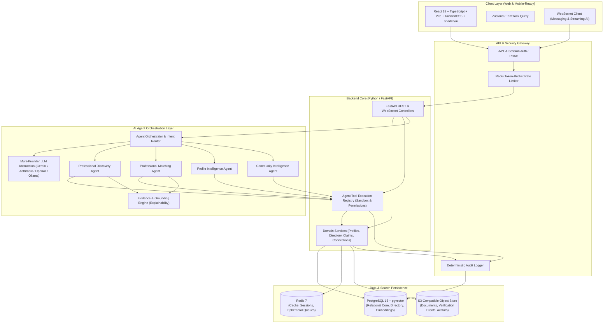

# Legal Professionals Network — Master Project Blueprint

## Executive Summary

The **AI-Agent-Native Legal Professional Network** is an enterprise-grade platform built specifically for advocates, senior advocates, law firms, in-house counsel, and legal consultants in India (starting with Tamil Nadu). 

Unlike standard directories or generic social networks, this platform is built around **explainable AI agents**, **hybrid semantic search**, and a **professional knowledge graph**, while maintaining strictly **deterministic** authentication, state transitions, verification, privacy controls, and audit trails.

---

## Documentation Index

The project architecture and implementation specifications are split into focused, modular markdown documents:

| Document | Description |
| :--- | :--- |
| **[01. System Architecture](file:///Users/apple/projects/legal-professionals-agent/docs/01_SYSTEM_ARCHITECTURE.md)** | End-to-end topology, tech stack (FastAPI, React/Vite, PostgreSQL/pgvector, Redis), security boundaries, and privacy design. |
| **[02. Data Models & Database Schema](file:///Users/apple/projects/legal-professionals-agent/docs/02_DATA_MODEL_AND_DATABASE.md)** | Entity relational models, PostgreSQL DDL schemas, pgvector indexes, graph relationship representations, and directory seed provenance. |
| **[03. AI Agent Architecture](file:///Users/apple/projects/legal-professionals-agent/docs/03_AI_AGENT_ARCHITECTURE.md)** | Agent orchestration pipeline, tool boundaries, Intent Router, Discovery Agent, Matching Agent, Profile Intelligence Agent, and Grounding/Explainability rules. |
| **[04. API Contracts & Specifications](file:///Users/apple/projects/legal-professionals-agent/docs/04_API_CONTRACTS.md)** | RESTful and WebSocket API endpoints, Pydantic request/response schemas, tool contracts, authentication, and error codes. |
| **[05. Frontend & UI Specification](file:///Users/apple/projects/legal-professionals-agent/docs/05_FRONTEND_SPECIFICATION.md)** | Screen-by-screen specifications for the 11 core application views, design tokens, component hierarchy, and interaction flows. |
| **[06. Implementation Roadmap](file:///Users/apple/projects/legal-professionals-agent/docs/06_IMPLEMENTATION_ROADMAP.md)** | Phased development plan (Phases 1–6), Phase 1 critical milestone breakdown, testing strategy, and definition of done. |
| **[07. Developer Setup Guide](file:///Users/apple/projects/legal-professionals-agent/docs/07_DEVELOPER_SETUP_GUIDE.md)** | Prerequisites, local Docker Compose orchestration, backend/frontend environment setup, migrations, and test commands. |

---

## High-Level Architecture Diagram



---

## Core Engineering Principles

1. **AI Recommends, Determinism Decides**:
   - AI generates discovery rankings, matches, extraction drafts, and summaries.
   - Deterministic code handles user authentication, profile claiming, bar verification status, privacy visibility, and database mutations.
2. **Never Fabricate Credentials or Citations**:
   - Zero hallucination policy: If an advocate's availability or court experience is not explicitly recorded, the AI must label it as missing information rather than inferring or inventing it.
3. **Strict Separation of Directory Records and Active Users**:
   - Seed data (30,000 Tamil Nadu advocates) lives as `DirectoryRecord` entities.
   - An advocate only becomes a `User` and `ProfessionalProfile` through a strictly verified claim and onboarding workflow.
4. **Tool Isolation for Agents**:
   - Agents never query or mutate SQL directly. They operate strictly via typed, authenticated, and audited tools in the `ToolRegistry`.
5. **Multi-Provider LLM Independence**:
   - The system utilizes an abstract provider interface, allowing plug-and-play switching between local or hosted models without touching domain logic.

---

## Recommended Repository Layout

```text
legal-professionals-agent/
├── README.md                          # Original project vision & goals
├── PROJECT_BLUEPRINT.md               # Master architecture & navigation index
├── docs/                              # Formal architectural specifications
│   ├── 01_SYSTEM_ARCHITECTURE.md
│   ├── 02_DATA_MODEL_AND_DATABASE.md
│   ├── 03_AI_AGENT_ARCHITECTURE.md
│   ├── 04_API_CONTRACTS.md
│   ├── 05_FRONTEND_SPECIFICATION.md
│   └── 06_IMPLEMENTATION_ROADMAP.md
├── backend/                           # FastAPI Python Backend
│   ├── app/
│   │   ├── api/                       # API routes (v1)
│   │   ├── core/                      # Config, security, database sessions
│   │   ├── models/                    # SQLAlchemy / SQLModel ORM entities
│   │   ├── schemas/                   # Pydantic schemas (DTo / API contracts)
│   │   ├── services/                  # Business logic layer
│   │   ├── agents/                    # AI agents, orchestrator, prompts
│   │   │   ├── orchestrator.py
│   │   │   ├── discovery.py
│   │   │   ├── matching.py
│   │   │   ├── profile_intelligence.py
│   │   │   ├── community.py
│   │   │   └── tools/                 # Tool registry & definitions
│   │   └── llm/                       # Provider abstractions
│   ├── tests/                         # Unit and integration tests
│   ├── alembic/                       # Database migrations
│   ├── Dockerfile
│   └── pyproject.toml / requirements.txt
├── frontend/                          # React + TypeScript + Vite Frontend
│   ├── src/
│   │   ├── assets/
│   │   ├── components/                # Reusable UI components & shadcn
│   │   ├── features/                  # Domain screens & workflows
│   │   │   ├── auth/
│   │   │   ├── directory/
│   │   │   ├── profile/
│   │   │   ├── search/
│   │   │   ├── services/
│   │   │   ├── community/
│   │   │   └── network/
│   │   ├── hooks/
│   │   ├── lib/                       # API clients, utilities
│   │   └── types/                     # Shared TypeScript interfaces
│   ├── package.json
│   ├── tsconfig.json
│   └── vite.config.ts
└── docker-compose.yml                 # Local dev orchestration (Postgres, Redis, Backend, Frontend)
```
