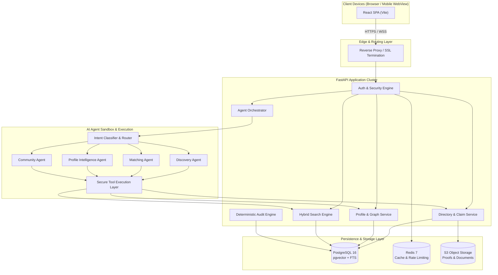

# System Architecture & Technical Design

## 1. Architectural Philosophy

The **Legal Professionals Network** is architected to solve a critical trust problem in professional platforms: **balancing autonomous AI agent reasoning with strictly deterministic legal, security, and verification guarantees.**

Traditional AI applications either relegate AI to an isolated sidebar chatbot or delegate critical decisions blindly to LLMs. This platform operates on the principle of **Agentic Augmentation with Deterministic Boundaries**:

```text
┌────────────────────────────────────────────────────────────────────────┐
│                        USER INTENT & WORKSPACE                         │
└───────────────────────────────────┬────────────────────────────────────┘
                                    │
                  ┌─────────────────┴─────────────────┐
                  ▼                                   ▼
      ┌─────────────────────────┐         ┌─────────────────────────┐
      │   AI Agent Reasoning    │         │  Deterministic Platform │
      │   (Non-Deterministic)   │         │     (Deterministic)     │
      ├─────────────────────────┤         ├─────────────────────────┤
      │ • Intent Parsing        │         │ • Authentication / JWT  │
      │ • Semantic Search       │         │ • Bar ID Verification   │
      │ • Profile Insights      │         │ • Claim Lifecycle       │
      │ • Match Explanations    │         │ • Privacy Masking       │
      │ • Discussion Summaries  │         │ • Audit Trail Logging   │
      │ • Candidate Ranking     │         │ • Relationship Storage  │
      └───────────┬─────────────┘         └───────────┬─────────────┘
                  │                                   │
                  └─────────────────┬─────────────────┘
                                    │
                                    ▼
┌────────────────────────────────────────────────────────────────────────┐
│              HUMAN-IN-THE-LOOP VERIFICATION & CONFIRMATION             │
└────────────────────────────────────────────────────────────────────────┘
```

---

## 2. Technology Stack & Component Specifications

| Tier | Component | Technology Selected | Rationale |
| :--- | :--- | :--- | :--- |
| **Frontend** | Web Application | **React 18 + TypeScript + Vite** | Fast SPA compilation, enterprise type safety, modular micro-frontends, responsive mobile-first architecture. |
| **Frontend** | Styling & UI Kit | **Tailwind CSS + shadcn/ui** | High-performance vanilla-friendly CSS, accessible Radix primitives, consistent design system for legal workflows. |
| **Frontend** | State Management | **TanStack Query (React Query) + Zustand** | Asynchronous server-state synchronization with local lightweight store for agent chats and filters. |
| **Backend** | Application Server | **Python 3.11+ / FastAPI** | High-throughput asynchronous I/O, native Pydantic v2 validation, first-class Python AI/LLM ecosystem integration. |
| **ORM / Migrations**| Data Access | **SQLAlchemy 2.0 (Async) + Alembic** | Robust connection pooling, async queries, relational integrity, clean schema migration tooling. |
| **Database** | Relational & Vector | **PostgreSQL 16 + pgvector** | Unified transactional consistency (ACID) + cosine similarity vector indexing (`HNSW`/`IVFFlat`) in a single store. |
| **Cache & Realtime** | Distributed State | **Redis 7** | Sub-millisecond session caching, rate limiting (token bucket), pub/sub for agent streaming and notifications. |
| **Object Storage** | Blob / Documents | **MinIO (Local Dev) / S3-Compatible** | Encrypted storage for Bar Council certificates, verification proofs, profile media. |
| **AI Abstraction** | LLM Provider Layer | **Multi-Provider Adapter (LiteLLM / Custom Adapter)** | Agnostic routing between Google Gemini, Anthropic Claude, OpenAI, and local Ollama models. |

---

## 3. System Component Architecture



---

## 4. Security & Privacy Architecture

### 4.1 Authentication & Authorization
- **JWT Authentication**: Short-lived Access Tokens (15 minutes) paired with HttpOnly, Secure, SameSite Refresh Tokens stored in Redis with revocation checks.
- **Deterministic Role-Based Access Control (RBAC)**:
  - `GUEST`: Unauthenticated visitor; can view public directory stubs only.
  - `CLAIM_PENDING`: Advocate claiming a profile; restricted to verification upload actions.
  - `ADVOCATE_UNVERIFIED`: Registered user awaiting Bar ID verification; basic browsing, limited messaging.
  - `ADVOCATE_VERIFIED`: Confirmed Bar Council member; full access to directory search, referrals, connections, services, community.
  - `SENIOR_ADVOCATE`: Designated Senior Counsel; special designation badge and referral routing.
  - `FIRM_ADMIN`: Legal entity manager; manages multi-lawyer accounts.
  - `PLATFORM_ADMIN`: Internal operator; auditing, verification review, compliance management.

### 4.2 Privacy Boundaries & Seed Data Provenance
1. **Directory Record Isolation**:
   - The initial seed dataset of 30,000 Tamil Nadu advocates contains public records (Name, Enrollment Number, District, Bar Association).
   - Sensitive personal information (e.g. parentage/father's name, residential address, personal phone numbers) is strictly **scrubbed or concealed** in database storage.
   - A Directory Record is flagged with:
     ```json
     {
       "record_status": "UNCLAIMED",
       "is_verified": false,
       "profile_type": "DIRECTORY_STUB"
     }
     ```
2. **Deterministic Privacy Masks**:
   - Contact numbers and email addresses are masked by default (`+91 98****1234`).
   - Profile owners configure 3 visibility levels per field: `PUBLIC`, `VERIFIED_MEMBERS_ONLY`, `MUTUAL_CONNECTIONS_ONLY`.
   - Contact exchange occurs only when both parties explicitly accept a Connection or Service Request.

---

## 5. Hybrid Search Architecture

The platform combines three distinct retrieval strategies to ensure both high precision (deterministic criteria) and high recall (semantic natural language intent):

```text
User Natural Language Query:
"Salem lawyer for criminal appeal in Sessions Court with appearance service"
                                    │
                                    ▼
                     Intent Agent Parsing (Pydantic)
      ┌─────────────────────────────┴─────────────────────────────┐
      │ Structured Criteria:                                      │
      │ • location: "Salem"                                       │
      │ • practice_area: "Criminal Law"                           │
      │ • court: "Principal Sessions Court"                       │
      │ • service: "Court Appearance" / "Local Counsel"           │
      │ • semantic_context: "criminal appeal sessions court"      │
      └─────────────────────────────┬─────────────────────────────┘
                                    │
        ┌───────────────────────────┼───────────────────────────┐
        ▼                           ▼                           ▼
[Relational SQL Filter]     [Full-Text Search]          [pgvector HNSW]
- district = 'Salem'        - ts_rank(search_vector)    - cosine_distance(
- verified = true           - matches "appeal",           profile_embedding,
- service = 'appearance'      "sessions"                  query_embedding)
        │                           │                           │
        └───────────────────────────┼───────────────────────────┘
                                    │
                                    ▼
                   Reciprocal Rank Fusion (RRF) Scorer
                                    │
                                    ▼
           Deterministic Evidence Validation (Grounding Layer)
                                    │
                                    ▼
                     Ranked, Explainable Results
```

1. **Relational Pushdown**: Rigid filters (jurisdiction, verified badge, active service flags) eliminate irrelevant candidates before semantic ranking.
2. **PostgreSQL Full-Text Search (FTS)**: Lexical matching on specialized terms, legal acts, and specific court names.
3. **pgvector Embeddings**: Dense semantic vector embeddings (1536-dim or 768-dim) capturing contextual semantics of bio, experience, and practice descriptions.
4. **Evidence Grounding Engine**: Ensures every ranking factor maps directly to verified profile attributes.

---

## 6. Auditability & Compliance

Every AI action is logged in an append-only, tamper-evident audit store (`audit_logs` table):

```json
{
  "event_id": "aud_01HXYZ789...",
  "timestamp": "2026-10-22T20:45:00Z",
  "actor_id": "usr_advocate_123",
  "agent_name": "ProfessionalDiscoveryAgent",
  "intent_detected": "DISCOVERY_LOCAL_COUNSEL",
  "tools_invoked": [
    "search_professionals_by_criteria",
    "get_professional_profile"
  ],
  "retrieved_candidates_count": 8,
  "recommended_profiles": ["prof_456", "prof_789"],
  "grounding_evidence": {
    "prof_456": ["Salem location matched", "Criminal law declared", "Sessions court listed"]
  },
  "confidence_rating": "HIGH",
  "user_accepted_action": "VIEW_PROFILE"
}
```

This guarantees end-to-end accountability and ensures the platform complies with Indian Bar Council ethics standards regarding professional discoverability.
