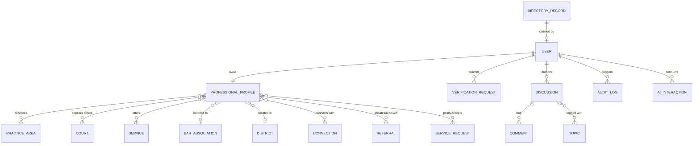

# Data Model & Database Schema Specification

## 1. Relational Data Architecture

The platform uses **PostgreSQL 16** with the **`pgvector`** extension. The data model is strictly normalized to decouple **unclaimed directory seed records** from **active verified user profiles**, while providing graph adjacency tables for professional networking.



---

## 2. Core PostgreSQL DDL & Entity Schemas

### 2.1 Enums and Extensions

```sql
CREATE EXTENSION IF NOT EXISTS "uuid-ossp";
CREATE EXTENSION IF NOT EXISTS "pgcrypto";
CREATE EXTENSION IF NOT EXISTS "vector";

-- Verification and Record Status
CREATE TYPE record_status_enum AS ENUM (
    'UNCLAIMED',
    'CLAIMED',
    'VERIFICATION_PENDING',
    'VERIFIED',
    'VERIFICATION_FAILED',
    'SUSPENDED'
);

CREATE TYPE user_role_enum AS ENUM (
    'GUEST',
    'ADVOCATE_UNVERIFIED',
    'ADVOCATE_VERIFIED',
    'SENIOR_ADVOCATE',
    'FIRM_ADMIN',
    'PLATFORM_ADMIN'
);

CREATE TYPE privacy_level_enum AS ENUM (
    'PUBLIC',
    'VERIFIED_MEMBERS_ONLY',
    'MUTUAL_CONNECTIONS_ONLY',
    'HIDDEN'
);

CREATE TYPE service_request_status_enum AS ENUM (
    'OPEN',
    'IN_REVIEW',
    'MATCHED',
    'ACCEPTED',
    'DECLINED',
    'COMPLETED',
    'CANCELLED'
);

CREATE TYPE connection_status_enum AS ENUM (
    'PENDING',
    'ACCEPTED',
    'DECLINED',
    'BLOCKED'
);
```

---

### 2.2 Directory Records (Seed Isolation)

```sql
CREATE TABLE directory_records (
    id UUID PRIMARY KEY DEFAULT gen_random_uuid(),
    enrollment_number VARCHAR(100) UNIQUE NOT NULL, -- e.g., "MS/1234/2012"
    full_name VARCHAR(255) NOT NULL,
    gender VARCHAR(20),
    bar_association_name VARCHAR(255),
    district_name VARCHAR(100) NOT NULL,
    source_name VARCHAR(100) DEFAULT 'Tamil Nadu Advocate Directory 2024',
    source_provenance JSONB DEFAULT '{}'::jsonb,
    record_status record_status_enum DEFAULT 'UNCLAIMED' NOT NULL,
    claimed_user_id UUID,
    claimed_at TIMESTAMPTZ,
    created_at TIMESTAMPTZ DEFAULT clock_timestamp() NOT NULL,
    updated_at TIMESTAMPTZ DEFAULT clock_timestamp() NOT NULL
);

CREATE INDEX idx_directory_enrollment ON directory_records(enrollment_number);
CREATE INDEX idx_directory_district ON directory_records(district_name);
CREATE INDEX idx_directory_status ON directory_records(record_status);
```

---

### 2.3 Users & Authentication

```sql
CREATE TABLE users (
    id UUID PRIMARY KEY DEFAULT gen_random_uuid(),
    email VARCHAR(255) UNIQUE NOT NULL,
    phone_number VARCHAR(30) UNIQUE,
    password_hash VARCHAR(255) NOT NULL,
    role user_role_enum DEFAULT 'ADVOCATE_UNVERIFIED' NOT NULL,
    is_active BOOLEAN DEFAULT TRUE NOT NULL,
    is_verified BOOLEAN DEFAULT FALSE NOT NULL,
    last_login_at TIMESTAMPTZ,
    created_at TIMESTAMPTZ DEFAULT clock_timestamp() NOT NULL,
    updated_at TIMESTAMPTZ DEFAULT clock_timestamp() NOT NULL
);

CREATE INDEX idx_users_email ON users(email);
CREATE INDEX idx_users_role ON users(role);
```

---

### 2.4 Professional Profiles & Vector Embeddings

```sql
CREATE TABLE professional_profiles (
    id UUID PRIMARY KEY DEFAULT gen_random_uuid(),
    user_id UUID UNIQUE NOT NULL REFERENCES users(id) ON DELETE CASCADE,
    directory_record_id UUID REFERENCES directory_records(id) ON DELETE SET NULL,
    full_name VARCHAR(255) NOT NULL,
    enrollment_number VARCHAR(100) UNIQUE NOT NULL,
    designation VARCHAR(100) DEFAULT 'Advocate' NOT NULL,
    years_of_experience INTEGER DEFAULT 0 NOT NULL,
    bar_association_id UUID,
    district_id UUID,
    headline VARCHAR(255),
    bio TEXT,
    avatar_url TEXT,
    office_address TEXT,
    languages TEXT[] DEFAULT ARRAY['Tamil', 'English'],
    
    -- Privacy Settings
    phone_visibility privacy_level_enum DEFAULT 'MUTUAL_CONNECTIONS_ONLY' NOT NULL,
    email_visibility privacy_level_enum DEFAULT 'MUTUAL_CONNECTIONS_ONLY' NOT NULL,
    location_visibility privacy_level_enum DEFAULT 'PUBLIC' NOT NULL,
    
    -- AI Generated Structured Insights (Human Approved)
    ai_profile_insights JSONB DEFAULT '{}'::jsonb,
    is_profile_published BOOLEAN DEFAULT FALSE NOT NULL,
    
    -- Semantic Search & Matching Vector
    embedding vector(1536), -- e.g. text-embedding-3-small or Gemini text-embedding-004
    
    -- Full Text Search
    search_vector tsvector,

    created_at TIMESTAMPTZ DEFAULT clock_timestamp() NOT NULL,
    updated_at TIMESTAMPTZ DEFAULT clock_timestamp() NOT NULL
);

-- HNSW Vector Index for High-Speed Approximate Nearest Neighbor Matching
CREATE INDEX idx_profile_embedding_hnsw 
ON professional_profiles 
USING hnsw (embedding vector_cosine_ops)
WITH (m = 16, ef_construction = 64);

-- Full-Text Search GIN Index
CREATE INDEX idx_profile_search_vector 
ON professional_profiles 
USING gin (search_vector);
```

---

### 2.5 Master Taxonomy (Districts, Courts, Practice Areas, Services)

```sql
CREATE TABLE districts (
    id UUID PRIMARY KEY DEFAULT gen_random_uuid(),
    name VARCHAR(100) UNIQUE NOT NULL, -- e.g. "Salem", "Chennai", "Madurai", "Coimbatore"
    state VARCHAR(100) DEFAULT 'Tamil Nadu' NOT NULL,
    is_active BOOLEAN DEFAULT TRUE NOT NULL
);

CREATE TABLE courts (
    id UUID PRIMARY KEY DEFAULT gen_random_uuid(),
    name VARCHAR(255) NOT NULL, -- e.g. "Principal Sessions Court, Salem", "Madras High Court"
    court_type VARCHAR(100) NOT NULL, -- "Sessions", "District", "High Court", "Tribunal"
    district_id UUID REFERENCES districts(id),
    jurisdiction_details TEXT,
    UNIQUE(name, district_id)
);

CREATE TABLE practice_areas (
    id UUID PRIMARY KEY DEFAULT gen_random_uuid(),
    slug VARCHAR(100) UNIQUE NOT NULL,
    name VARCHAR(150) NOT NULL, -- e.g. "Criminal Law", "Constitutional Law", "Civil Litigation"
    description TEXT
);

CREATE TABLE services (
    id UUID PRIMARY KEY DEFAULT gen_random_uuid(),
    slug VARCHAR(100) UNIQUE NOT NULL,
    title VARCHAR(150) NOT NULL, -- e.g. "Court Appearance", "Local Counsel", "Legal Research", "Arbitration"
    category VARCHAR(100) NOT NULL
);
```

---

### 2.6 Graph Mapping Adjacency Tables

```sql
-- Profile to Practice Areas
CREATE TABLE profile_practice_areas (
    profile_id UUID NOT NULL REFERENCES professional_profiles(id) ON DELETE CASCADE,
    practice_area_id UUID NOT NULL REFERENCES practice_areas(id) ON DELETE CASCADE,
    years_focused INTEGER DEFAULT 1,
    is_primary BOOLEAN DEFAULT FALSE,
    PRIMARY KEY (profile_id, practice_area_id)
);

-- Profile to Courts (Appears Before)
CREATE TABLE profile_courts (
    profile_id UUID NOT NULL REFERENCES professional_profiles(id) ON DELETE CASCADE,
    court_id UUID NOT NULL REFERENCES courts(id) ON DELETE CASCADE,
    is_regular BOOLEAN DEFAULT TRUE,
    PRIMARY KEY (profile_id, court_id)
);

-- Profile to Services Offered
CREATE TABLE profile_services_offered (
    profile_id UUID NOT NULL REFERENCES professional_profiles(id) ON DELETE CASCADE,
    service_id UUID NOT NULL REFERENCES services(id) ON DELETE CASCADE,
    details TEXT,
    is_active BOOLEAN DEFAULT TRUE,
    PRIMARY KEY (profile_id, service_id)
);

-- Professional Connections (Graph Edge: CONNECTED_TO)
CREATE TABLE connections (
    id UUID PRIMARY KEY DEFAULT gen_random_uuid(),
    sender_profile_id UUID NOT NULL REFERENCES professional_profiles(id) ON DELETE CASCADE,
    receiver_profile_id UUID NOT NULL REFERENCES professional_profiles(id) ON DELETE CASCADE,
    status connection_status_enum DEFAULT 'PENDING' NOT NULL,
    initiated_at TIMESTAMPTZ DEFAULT clock_timestamp() NOT NULL,
    responded_at TIMESTAMPTZ,
    UNIQUE(sender_profile_id, receiver_profile_id)
);
```

---

### 2.7 Verification & Audit Tracking

```sql
CREATE TABLE verification_requests (
    id UUID PRIMARY KEY DEFAULT gen_random_uuid(),
    user_id UUID NOT NULL REFERENCES users(id) ON DELETE CASCADE,
    directory_record_id UUID REFERENCES directory_records(id),
    enrollment_number VARCHAR(100) NOT NULL,
    bar_council_id_card_doc_url TEXT NOT NULL,
    additional_id_doc_url TEXT,
    status record_status_enum DEFAULT 'VERIFICATION_PENDING' NOT NULL,
    admin_reviewer_id UUID REFERENCES users(id),
    rejection_reason TEXT,
    submitted_at TIMESTAMPTZ DEFAULT clock_timestamp() NOT NULL,
    resolved_at TIMESTAMPTZ
);

CREATE TABLE audit_logs (
    id UUID PRIMARY KEY DEFAULT gen_random_uuid(),
    actor_id UUID REFERENCES users(id) ON DELETE SET NULL,
    event_type VARCHAR(100) NOT NULL, -- e.g., 'CLAIM_SUBMITTED', 'AI_SEARCH_PERFORMED', 'PROFILE_VERIFIED'
    entity_name VARCHAR(100) NOT NULL,
    entity_id UUID,
    metadata JSONB NOT NULL DEFAULT '{}'::jsonb,
    ip_address VARCHAR(50),
    user_agent TEXT,
    created_at TIMESTAMPTZ DEFAULT clock_timestamp() NOT NULL
);

CREATE INDEX idx_audit_logs_actor ON audit_logs(actor_id);
CREATE INDEX idx_audit_logs_event_type ON audit_logs(event_type);
CREATE INDEX idx_audit_logs_created_at ON audit_logs(created_at);
```

---

## 3. Seed Ingestion Strategy (30,000 Advocates)

1. **ETL Pipeline**:
   - Source data parsed from official bar directory dumps into staging tables.
   - Clean enrollment numbers to normalized format: `[StateCode]/[Number]/[Year]` (e.g., `MS/1420/2018`).
   - Scrub sensitive family details (father's name, residential address).
   - Ingest in batches of 1,000 with atomic transaction boundaries.
2. **Provenance Preservation**:
   - `directory_records` stores original source name and ingest timestamp.
   - Initial state is strictly `UNCLAIMED`, `is_verified = FALSE`.
