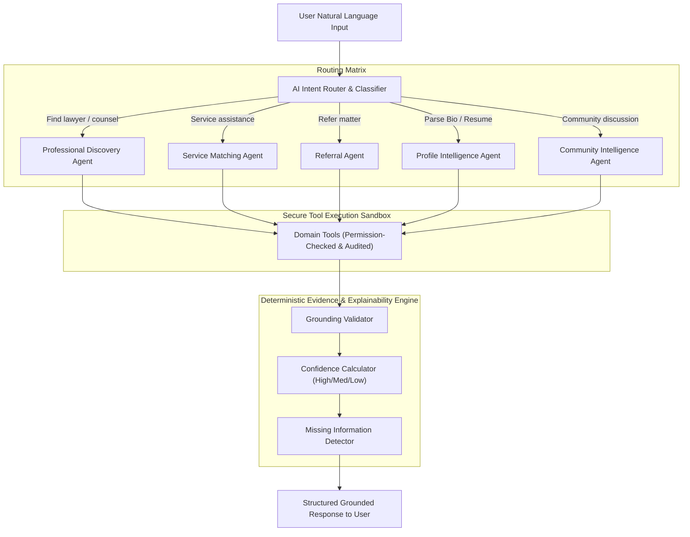

# AI Agent Architecture & Safety Engine

## 1. Multi-Agent Ecosystem Overview

The application abandons the generic monolithic chatbot paradigm in favor of a **coordinated multi-agent system** where specialized agents handle dedicated cognitive tasks. Every agent executes strictly via **typed tools** with deterministic validation, security checks, and audit logging.



---

## 2. Agent Catalog & Responsibilities

### 2.1 Intent Classifier & Router
- **Objective**: Parse incoming natural language and classify the action into one of:
  - `PROFESSIONAL_DISCOVERY`: Looking for an advocate, senior counsel, or local counsel.
  - `SERVICE_REQUEST`: Demanding or offering a legal service (e.g., appearance, drafting).
  - `REFERRAL_REQUEST`: Seeking a peer in another district/practice area to pass a client to.
  - `PROFILE_INGESTION`: Extracting resume or biography text into structured profile drafts.
  - `COMMUNITY_KNOWLEDGE`: Asking a peer network question or exploring forum discussions.
- **Safety Rule**: If intent is ambiguous or multi-part, the router asks a targeted clarifying question rather than guessing.

---

### 2.2 Professional Discovery Agent
- **Objective**: Identify the most qualified, verified legal professionals matching complex criteria.
- **Inputs**:
  - Jurisdiction / District (e.g. Salem, Madurai)
  - Court level (e.g. Principal Sessions Court, Madras High Court)
  - Practice Area (e.g. Criminal Law, Commercial Litigation)
  - Service Need (e.g. Local Counsel, Court Appearance)
  - Language Requirements (e.g. Tamil, English)
  - Experience threshold
- **Tools Available**:
  - `search_professionals_by_criteria()`
  - `get_professional_profile()`
  - `search_courts_by_district()`
  - `get_verification_status()`
- **Output Contract**:
  ```json
  {
    "matches": [
      {
        "profile_id": "prof_3892",
        "full_name": "Adv. S. Ramanathan",
        "designation": "Advocate",
        "district": "Salem",
        "primary_court": "Principal Sessions Court, Salem",
        "experience_years": 14,
        "is_verified": true,
        "matching_reasons": [
          "Criminal Law declared as primary practice area",
          "Regular appearance before Salem Principal Sessions Court",
          "Offers Court Appearance and Local Counsel services",
          "Fluent in Tamil and English"
        ],
        "evidence_keys": ["practice_areas.criminal", "courts.salem_sessions", "services.appearance"],
        "confidence": "HIGH",
        "missing_information": [
          "Current calendar availability for next 48 hours is not declared on profile"
        ]
      }
    ]
  }
  ```

---

### 2.3 Profile Intelligence Agent
- **Objective**: Read unstructured text (pasted CVs, resumes, LinkedIn summaries, or unstructured bios) and structure them into formal platform taxonomy.
- **Extraction Targets**:
  - Practice areas (mapped to official `practice_areas` taxonomy)
  - Courts appeared before (mapped to `courts` master list)
  - Specific legal services offered
  - Languages spoken
  - Bar council enrollment details
- **Crucial Constraint**: The agent outputs a **draft**. The advocate must manually inspect, adjust, and approve the extracted details before the profile is updated or published.

---

### 2.4 Service Matching Agent
- **Objective**: Match supply and demand for legal services.
  - *Example Demand*: "I need an advocate to handle a bail application appearance in Madurai District Court tomorrow."
  - *Action*: Extracts location, court, urgency, matter type, queries advocates offering `Court Appearance` in `Madurai` with active availability, and structures a private service request.
- **Constraint**: The agent does **not** execute financial transactions or guarantee representation; it facilitates professional peer connection.

---

### 2.5 Community Intelligence Agent
- **Objective**: Organize and distill collective wisdom from community discussion boards.
- **Capabilities**:
  - Topic tagging and deduplication.
  - Thread summarization highlighting consensus, dissenting views, and statutory/case citations mentioned by advocates.
  - Identification of subject-matter contributors based on past discussion contributions.
- **Safety Directive**: Thread summaries must explicitly carry the disclaimer: *"This summary is generated from peer discussions and does not constitute formal legal authority."*

---

### 2.6 Referral Agent
- **Objective**: Facilitate inter-lawyer matter referrals.
  - Evaluates geographical compatibility, non-conflicting practice areas, and existing 1st and 2nd degree network connections.
  - Presents candidate lawyers with transparent rationale: *"Adv. P is 1st-degree connected with your peer Adv. R, and practices Civil Appeals in Coimbatore."*

---

## 3. Tool Architecture & Sandboxing

Agents **never have direct SQL or ORM write access**. Every operation is performed via a typed Python tool function validated with Pydantic:

```python
from pydantic import BaseModel, Field
from typing import List, Optional
import uuid

class ProfessionalSearchInput(BaseModel):
    district: Optional[str] = Field(None, description="District name in Tamil Nadu, e.g. Salem, Madurai")
    practice_areas: List[str] = Field(default_factory=list, description="Legal practice domains, e.g. Criminal Law")
    court_name: Optional[str] = Field(None, description="Specific court name or type")
    required_service: Optional[str] = Field(None, description="Service slug, e.g. local-counsel, court-appearance")
    min_experience_years: Optional[int] = Field(0, description="Minimum years at the bar")
    must_be_verified: bool = Field(True, description="Strictly limit to verified advocates")
    limit: int = Field(10, le=50)

class ToolExecutionResult(BaseModel):
    success: bool
    data: dict
    audit_event_id: str
```

### Tool Execution Flow:
1. **Agent issues tool call**: Specifies tool name and JSON parameters.
2. **Tool Runner validates**: Verifies caller permissions and parameters against Pydantic schema.
3. **Database execution**: Invokes business service logic with tenant/user security context.
4. **Audit event recorded**: Input, output, and actor ID logged in `audit_logs`.
5. **Sanitized result returned**: Only authorized, non-private data returned to the agent context.

---

## 4. Grounding & Zero-Hallucination Guardrails

To prevent hallucinated credentials, all AI recommendation pipelines must pass through the **Evidence & Grounding Engine**:

```python
class GroundingCheck(BaseModel):
    claimed_assertion: str
    verified_profile_attribute: str
    is_grounded: bool

def ground_recommendations(profile: ProfessionalProfile, reason: str) -> GroundingCheck:
    """Verifies that each assertion in an AI matching reason exists in profile data."""
    # Deterministic validation logic checking profile schema fields
    ...
```

### The 4 Grounding Golden Rules:
1. **No Inferred Court Experience**: If a profile does not declare appearance before the "Madras High Court", the AI must **never** write "Regularly appears before High Court".
2. **No Invented Availability**: If calendar status is null, label: `Availability: Unknown / Not Declared`.
3. **Confidence Rating Metric**:
   - **HIGH**: $\ge 3$ verified direct attribute matches (Location + Exact Court + Practice Area).
   - **MEDIUM**: Location + Practice Area match, but specific court or service is unverified.
   - **LOW**: Semantic match only without explicit verification.
4. **Transparent Information Gaps**: Every recommendation card must include an *"Information Gaps / Missing Information"* badge.
