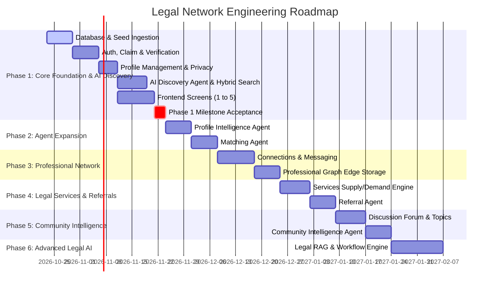

# Phased Implementation Roadmap & Engineering Plan

## 1. Phased Development Overview

The platform development is structured into 6 sequential phases, prioritizing a robust **deterministic foundation** and the **core AI discovery loop** before expanding into secondary social or knowledge capabilities.

---

## 2. Phase 1 Detailed Task Breakdown (The Critical Milestone)

> **Definition of Success for Phase 1**:
> A verified advocate can enter:
> *"I need a local counsel in Salem for a criminal matter."*
> The system understands the intent, executes a grounded hybrid search, returns relevant verified professionals, presents transparent reasons why they match, and allows the advocate to initiate connection.

### Sprint 1.1: Project Setup & Database Foundations
- [ ] Initialize Python backend with `FastAPI`, `SQLAlchemy 2.0`, `Pydantic v2`, and `Alembic`.
- [ ] Configure `docker-compose.yml` orchestrating `PostgreSQL 16` (with `pgvector`), `Redis 7`, and `MinIO`.
- [ ] Implement initial Alembic migrations:
  - `directory_records`
  - `users`
  - `professional_profiles`
  - `districts`, `courts`, `practice_areas`, `services`
  - `verification_requests`
  - `audit_logs`
- [ ] Write seed ingestion script to parse and load the initial 30,000 Tamil Nadu advocate records with status `UNCLAIMED`.

### Sprint 1.2: Authentication, Claiming & Verification Engine
- [ ] Implement deterministic JWT auth (access/refresh tokens) with password hashing (`argon2` / `bcrypt`).
- [ ] Build Role-Based Access Control (RBAC) middleware verifying roles (`GUEST`, `ADVOCATE_UNVERIFIED`, `ADVOCATE_VERIFIED`).
- [ ] Implement Profile Claim API:
  - Matching claimed enrollment number against `directory_records`.
  - Secure upload of Bar Council ID cards to S3/MinIO.
  - Creation of pending `verification_requests`.
- [ ] Implement platform admin verification approval/rejection endpoints with audit logging.

### Sprint 1.3: Professional Profile & Privacy Layer
- [ ] Implement Profile CRUD APIs.
- [ ] Enforce field-level privacy masking (mask phone and email unless mutual connection exists).
- [ ] Implement taxonomy association endpoints (`profile_practice_areas`, `profile_courts`, `profile_services`).
- [ ] Setup profile embedding generation background task using `pgvector`.

### Sprint 1.4: AI Intent Router & Discovery Agent
- [ ] Create LLM provider abstraction layer (`BaseLLMClient` supporting Gemini, OpenAI, Claude, Ollama).
- [ ] Implement `IntentRouter`: classifies user queries into `PROFESSIONAL_DISCOVERY`.
- [ ] Build `ProfessionalDiscoveryAgent` with typed tools:
  - `search_professionals_by_criteria()`
  - `get_professional_profile()`
- [ ] Implement Hybrid Search engine in PostgreSQL:
  - Relational filter pushdown (district, verified status)
  - Full-Text Search (`tsvector` lexical rank)
  - `pgvector` Cosine similarity rank
  - Reciprocal Rank Fusion (RRF) algorithm.
- [ ] Implement **Evidence & Grounding Engine**:
  - Validates that every AI reason directly references declared profile attributes.
  - Computes confidence (`HIGH`, `MEDIUM`, `LOW`).
  - Identifies missing information (e.g., calendar availability).

### Sprint 1.5: Frontend Application (Phase 1 Screens)
- [ ] Initialize React 18 + Vite + TypeScript application with Tailwind CSS and `shadcn/ui`.
- [ ] Implement Screen 1: Welcome & Landing.
- [ ] Implement Screen 2: AI Professional Search with natural language bar and filter drawers.
- [ ] Implement Screen 3: AI Search Results with grounded reason checkmarks and confidence badges.
- [ ] Implement Screen 4: Professional Profile view.
- [ ] Implement Screen 5: Claim Profile modal with document upload.

### Sprint 1.6: End-to-End Milestone Testing & Validation
- [ ] End-to-end integration test verifying the Salem criminal local counsel query flow.
- [ ] Zero-hallucination verification test suite ensuring nonexistent courts/services are never returned.
- [ ] Security audit on privacy masking and unauthenticated data leakage.

---

## 3. Subsequent Phases (High-Level Summary)

### Phase 2: AI Enhancements
- **Profile Intelligence Agent**: Resume/CV text parsing and interactive preview editor.
- **Professional Matching Agent**: Bidirectional peer-to-peer recommendation engine.

### Phase 3: Professional Network
- Bidirectional Connection requests with notes.
- Secure professional 1-on-1 messaging.
- In-memory graph adjacency queries for 1st and 2nd degree network reach.

### Phase 4: Legal Services & Referrals
- Structured service requests (Court Appearance, Local Counsel, Drafting).
- **Referral Agent**: Identifies non-competing cross-district advocates to pass matters to.

### Phase 5: Community Intelligence
- Moderated discussion boards by practice area.
- **Community Intelligence Agent**: Automatic thread summarization, deduplication, and topic clustering.

### Phase 6: Advanced Legal AI
- Retrieval-Augmented Generation (RAG) on verified statutory frameworks and High Court/Supreme Court judgments.
- Workflow orchestration for litigation document checklists.

---

## 4. Definition of Done (DoD) Checklist

For each feature to be accepted:
1. **Type Safety**: Zero TypeScript compiler warnings and 100% Pydantic type compliance.
2. **Auditability**: Every mutation or AI recommendation generates an audit record in `audit_logs`.
3. **Grounding Guarantee**: 0% hallucinated qualifications verified through automated regression tests.
4. **Deterministic Security**: All private contact information masked by default.
5. **Responsive UX**: Optimized for desktop monitors and mobile browser viewports.
