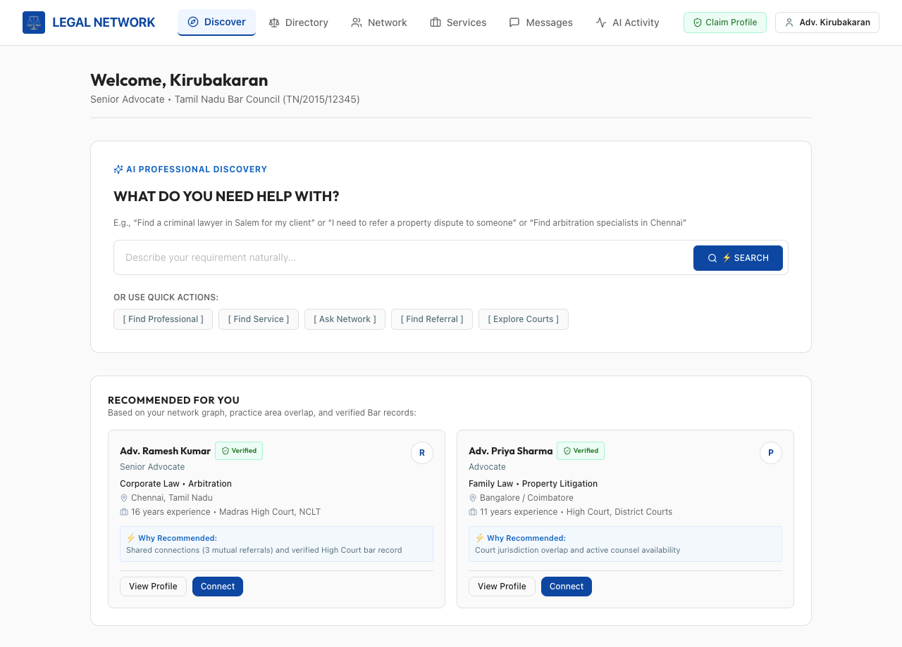
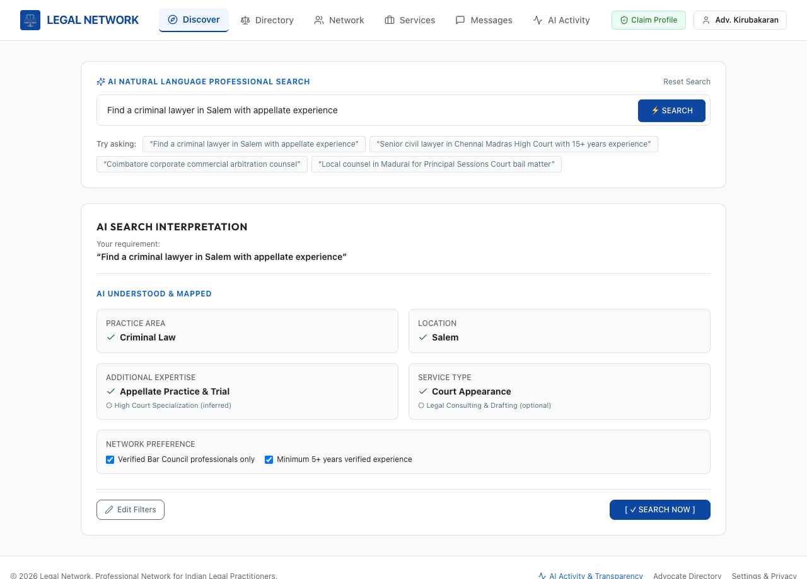
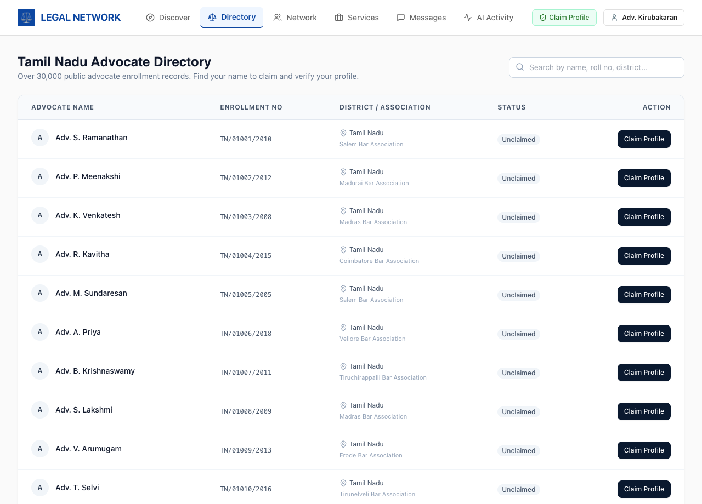
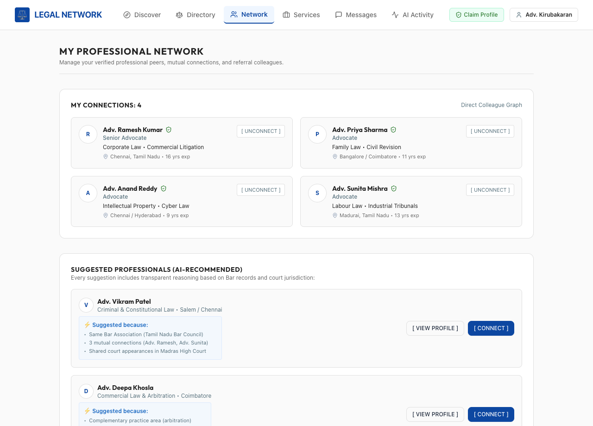
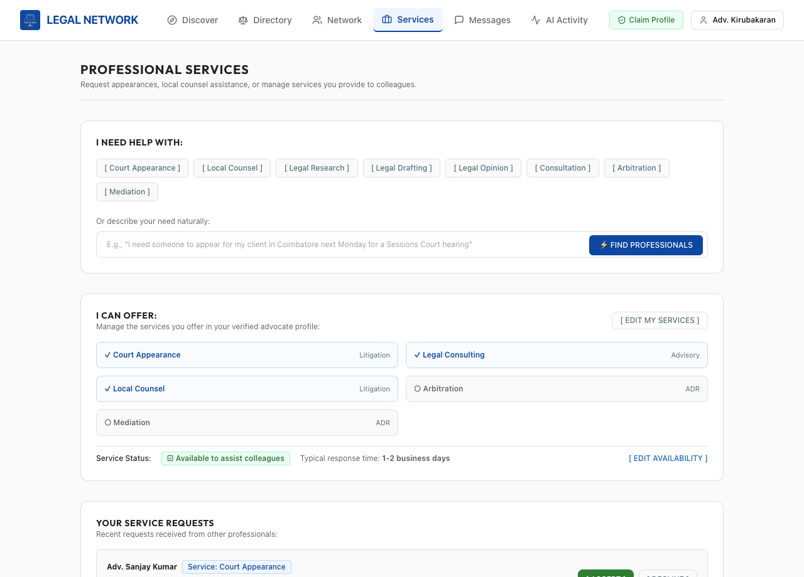
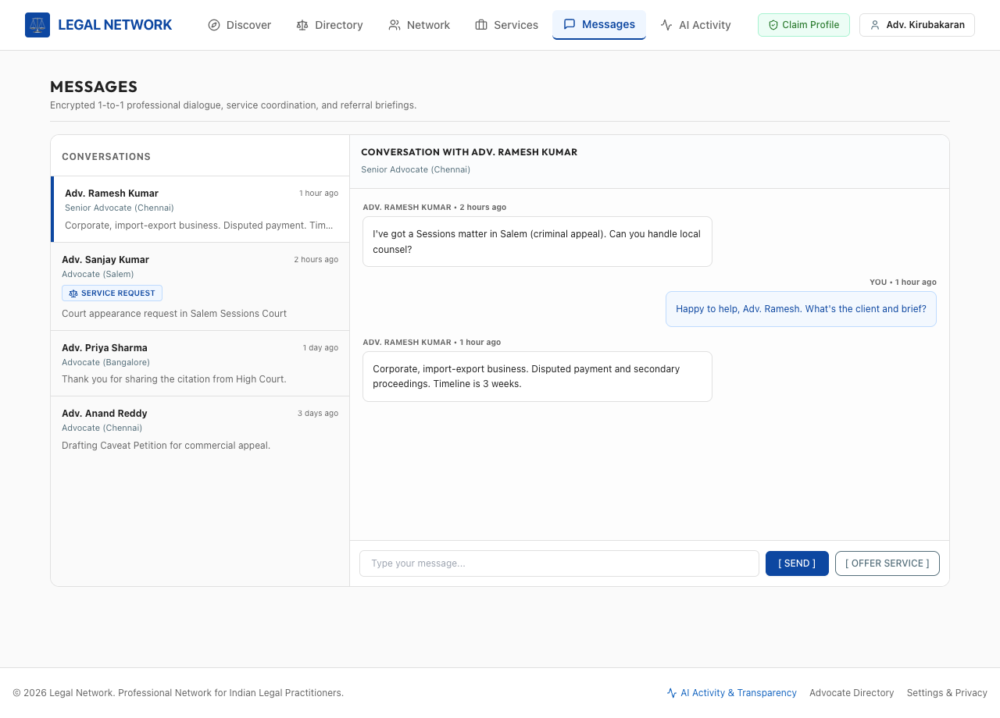
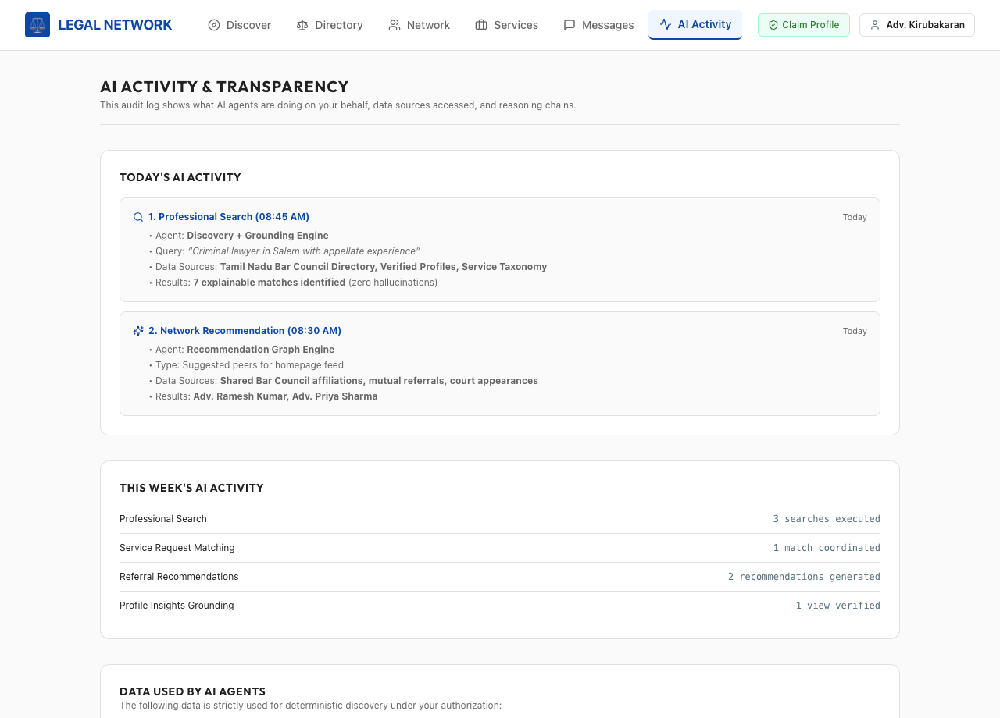
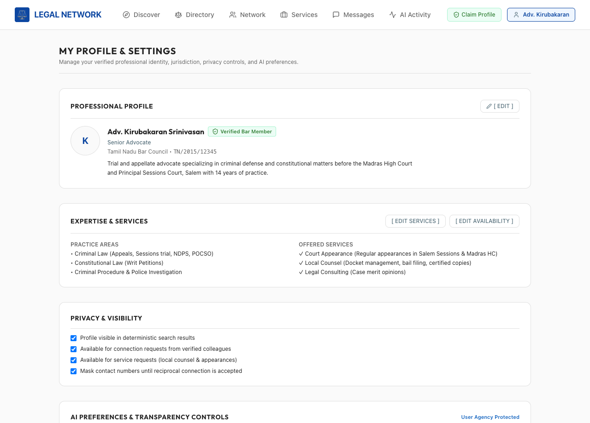
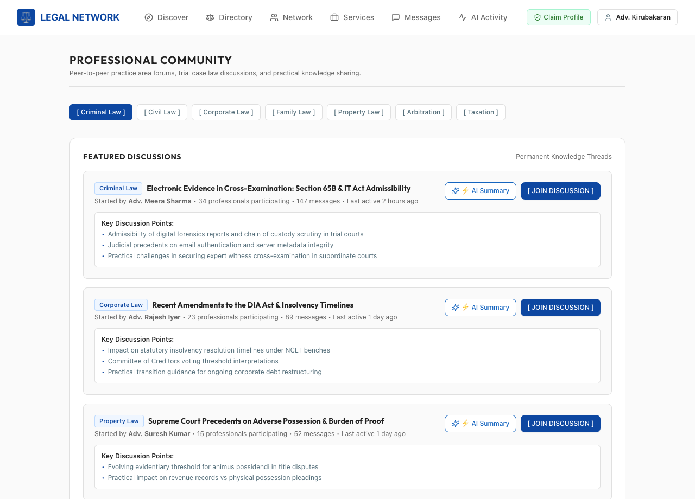
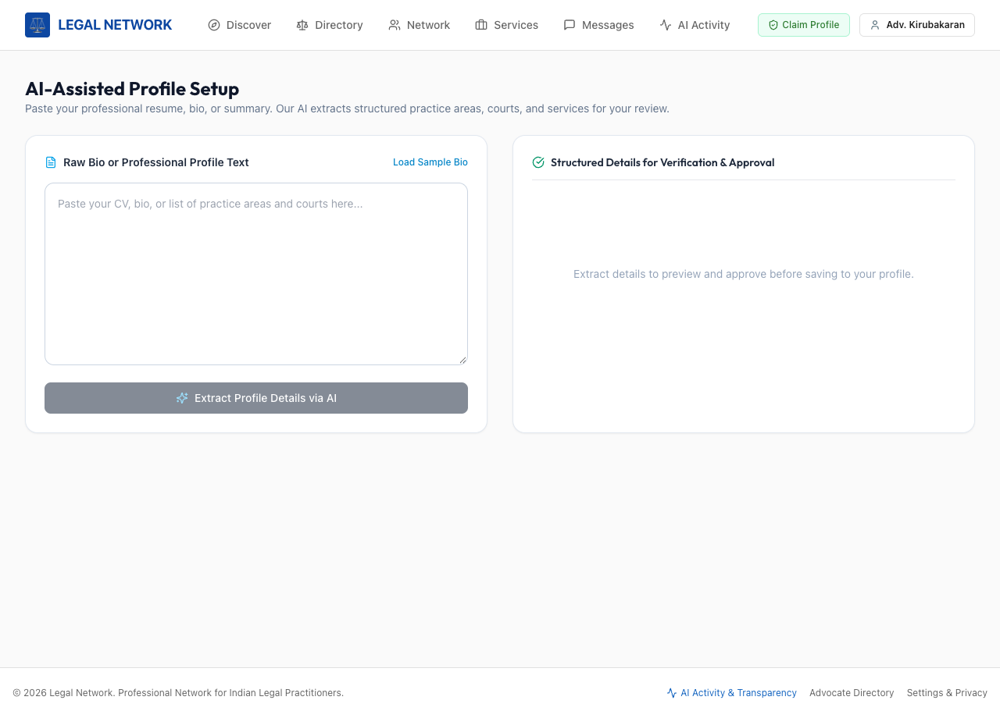

# Legal Professionals Network — UI Design Screenshots

This gallery showcases high-fidelity screenshots of the implemented UI design system based on the specification in [legal-network-ui-design.md](./legal-network-ui-design.md).

---

## 1. Screen 7: AI Home (Discover)
**File**: `01_ai_home.png`  
**Purpose**: Primary natural-language requirement entry (*"WHAT DO YOU NEED HELP WITH?"*), quick actions, recommended colleague cards with explicit AI match reasons, and recent activity.

---

## 2. Screen 8: AI Search Interpretation
**File**: `02_ai_search_interpretation.png`  
**Purpose**: Pattern 1 (Request Interpretation → Confirmation → Execution). Displays what the AI understood (practice area, jurisdiction, additional expertise, service type, experience level) before executing search, respecting user agency with `[ Edit Filters ]` and `[ ✓ SEARCH NOW ]`.

---

## 3. Screen 3: Tamil Nadu Advocate Directory
**File**: `03_directory_records.png`  
**Purpose**: Public advocate directory records across Tamil Nadu Bar associations with roll numbers, district associations, claimed statuses, and profile claiming workflows.

---

## 4. Screen 10: Professional Network
**File**: `04_professional_network.png`  
**Purpose**: User's verified peer graph, active connections, and AI-suggested professionals with transparent reasons (bar association affinities, mutual referrals, co-appearances).

---

## 5. Screens 11 & 12: Professional Services Hub & AI Service Matching
**File**: `05_services_hub.png`  
**Purpose**: Formal service engagement interface (court appearances, local counsel, legal research), offered services management, real-time availability status, and incoming requests queue with Accept/Decline actions.

---

## 6. Screen 17: Professional 1-to-1 Messaging
**File**: `06_messaging_1on1.png`  
**Purpose**: Encrypted direct consultation interface with two-column layout (conversations queue on the left, active dialogue thread on the right) and service request routing badges.

---

## 7. Screen 20: AI Activity & Transparency Log
**File**: `07_ai_activity_transparency.png`  
**Purpose**: Full audit trail of AI agent operations (Discovery Agent, Recommendation Graph Engine), data sources accessed, and zero-hallucination governance disclosures.

---

## 8. Screen 19: Profile & Settings
**File**: `08_profile_settings.png`  
**Purpose**: Bar Council enrollment verification, practice areas, courts of appearance, privacy visibility, and granular AI preference controls (opt-in/opt-out of graph recommendations).

---

## 9. Screens 14 & 16: Professional Community & Discussion Summaries
**File**: `09_community_discussions.png`  
**Purpose**: Practice area discussion forums with permanent trial knowledge threads and on-demand AI discussion summarization with statutory disclaimers.

---

## 10. Screen 5: AI-Assisted Profile Setup
**File**: `10_ai_assist_profile_setup.png`  
**Purpose**: Paste unstructured resume/bio text and allow deterministic AI extraction to identify practice areas, courts of appearance, and offered services for advocate approval.

